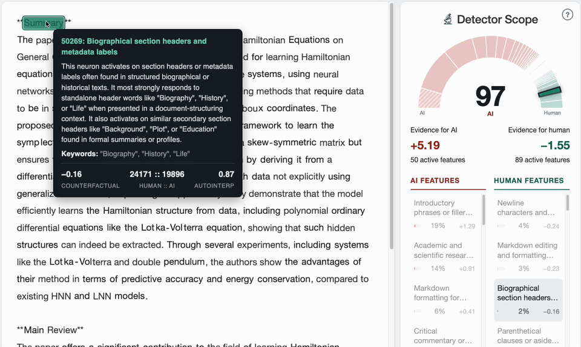
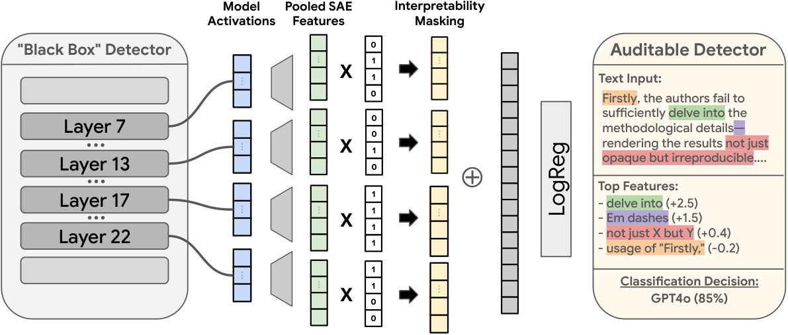
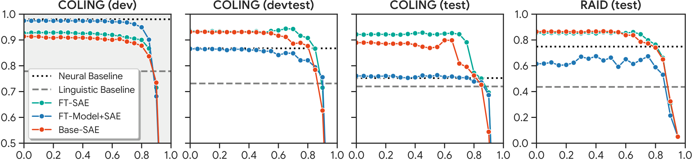

<h1 align="center">🔬 DetectorScope 🔬</h1>
<!-- 
<p align="center">
  <a href="https://huggingface.co/spaces/liamdugan/detector-scope-demo"><b>hf.co/spaces/liamdugan/detector-scope-demo</b></a>
</p> -->

<p align="center">
  <b>AI text detectors that show their work.</b>
</p>

<p align="center">
  <a href="https://pypi.org/project/detectorscope/"></a>
  <a href="https://huggingface.co/spaces/liamdugan/detector-scope-demo"></a>
  <a href="https://arxiv.org/abs/2610.30006"></a>
  <a href="LICENSE"></a>
  <br />
  <a href="https://deepmind.google/"></a>
  <a href="https://nlp.cis.upenn.edu/"></a>
</p>

<p align="center">
  
</p>

DetectorScope turns a black-box AI text detector into one whose every
prediction is a sum of named, validated features. It can tell you which properties of a text made it predict "AI" and where in the text they are located.


<p align="center">
  Try our demo! <a href="https://huggingface.co/spaces/liamdugan/detector-scope-demo"><b>🤗 https://huggingface.co/spaces/liamdugan/detector-scope-demo</b></a>
</p>

<div align="center">
  <table class="docutils align-default">
    <tbody>
        <tr>
          <td>
            <p align="center"><b>Installation</b></p> <pre lang="bash">pip install detectorscope</pre>
          </td>
        </tr>
    </tbody>
    <tbody>
        <tr>
          <th class="head">Example Usage</th>
        </tr>
    </tbody>
    <tbody>
        <tr>
          <td>

```py
from detectorscope import AuditableDetector

# Load the AI detector
detector = AuditableDetector.from_pretrained(
  "liamdugan/detector-scope"
)

# Run the AI detector on some input
output = detector(
  "Like I said, this is about accuracy, about speed, and about cost."
)

# Print the results
print(output)
```
&nbsp;
          </td>
        </tr>
    </tbody>
    <tbody>
        <tr>
          <th class="head">Output</th>
        </tr>
    </tbody>
    <tbody>
        <tr>
          <td>

```
Detection(label='ai', p_ai=0.88, features=[
  Feature(importance=+0.23, description='the word about used as a preposition'),
  Feature(importance=+0.14, description='repeated phrases or sequences in text'),
  Feature(importance=-0.05, description='conversational filler phrase like i said'),
  ...])
```
&nbsp;
          </td>
        </tr>
    </tbody>
  </table>
</div>

Using DetectorScope you can:

* 🔍 **Query a strong AI detector** that is transparent about the features it uses
* 🖱️ **Hover over the text** to see the specific "AI Phrases" the detector is using
* 🔁 **Convert your own black-box detector** into an auditable one by using our pipeline
* 🎓 **Analyze LLM Outputs** so that you understand which models have which tendencies

## News

* **[25 Oct 2026]** DetectorScope will appear at EMNLP 2026 in Budapest, Hungary!

## Overview

<br />
<p align="center">
  
  <br />
  <sub><i>The pipeline: SAEs on the detector's residual stream, a description and validation score per feature, a threshold on that score, and a sparse head over the features that pass.</i></sub>
</p>
<br />

A DetectorScope detector is a concept bottleneck over interpretable sparse-autoencoder
features: the language model's residual stream is encoded by SAEs, each feature
gets a natural-language description that is validated against its own
activations, and a sparse linear head over the validated features makes the
decision. The prediction is therefore a sum of per-feature contributions, and
every contribution has a description and a location in the text.

## Results

<br />
<p align="center">
  
  <br />
  <sub><i>F1 (COLING) and TPR at 5% FPR (RAID) against the interpretability threshold, in domain (grey) and out of domain (white). FT-Model+SAE matches the underlying neural detector even at thresholds of 0.7 and above.</i></sub>
</p>
<br />

Across both benchmarks applying our auditable pipeline has minimal adverse effects on performance. The auditable detectors stay close to the fine-tuned
black-box classifier they are built on. The full tables are in the
[paper](https://arxiv.org/abs/2610.30006).

---

## Installation

From PyPI, in a fresh environment:

```bash
python -m venv .venv && source .venv/bin/activate
pip install detectorscope
```

From source, with the extras for the pipeline, the experiments and the demo:

```bash
git clone https://github.com/google-deepmind/detectorscope && cd detectorscope
pip install -e ".[all]"
```

## Usage

Any released detector loads by its Hub id; the other settings of a repo are
its branches.

```py
from detectorscope import AuditableDetector

detector = AuditableDetector.from_pretrained("liamdugan/detector-scope-peer-review-gpt4o")
detector = AuditableDetector.from_pretrained("liamdugan/detector-scope", revision="base-sae")
```

`detector(text)` returns a `Detection` with `label`, `p_ai`, `logit`, `bias` and
`features`, every feature active in the text with a non-zero effect, largest
first. `importance` is how much the logit falls if the feature is silenced,
and `logit == bias + sum(importances)`. A list of texts returns a list.

Set `return_highlights=True` to see where each feature is localized within the text:

```py
output = detector(text, return_highlights=True)
output.tokens                   # the text as tokens
output.features[0].highlights   # [(token index, activation), ...]
```

You can use the `tau` parameter to control the tradeoff between
interpretability and accuracy. Every feature has an auto-interpretation score,
how well its description predicts where it fires, and `tau` is the score a
feature must reach before the head is allowed to use it. A higher `tau` gives
the head fewer, better-described features, so every item of evidence it reports
is one you can read and check, at some cost in accuracy. A lower `tau` admits
more features, including ones whose descriptions are loose, and the detector
gets more accurate and less legible. The default is 0.85.

```py
detector = AuditableDetector.from_pretrained("liamdugan/detector-scope", tau=0.95)
```

`tau` runs from 0.00 (every feature) to 0.95 in steps of 0.05, and each branch
carries a head at every step, so changing it downloads nothing. It can also be
set per call, which is the easiest way to compare the same text at several
settings:

```py
output = detector(text, tau=0.50)   # more features, higher accuracy
output = detector(text, tau=0.95)   # the few best-described features
detector.heads                      # every (head, tau) pair the repo holds
```

`head="xgboost"`, on `from_pretrained` or on the call, selects the gradient-boosted
head at the same `tau` instead of the logistic-regression one.

## Models

We provide the following model collections for download via [Huggingface](https://huggingface.co/collections/liamdugan/detector-scope-6ad9ea7de8657f7da766b2b5):

| Repo | Domain and data |
|---|---|
| [`detector-scope`](https://huggingface.co/liamdugan/detector-scope) | open domain: the COLING 2025 GenAI Detection shared task (news, essays, reviews and more; 40 generators) |
| [`detector-scope-peer-review-gpt4o`](https://huggingface.co/liamdugan/detector-scope-peer-review-gpt4o) | closed domain: machine-learning peer reviews, human vs. GPT-4o (the AI Peer Review Detection Benchmark) |
| [`detector-scope-peer-review-llama`](https://huggingface.co/liamdugan/detector-scope-peer-review-llama) | closed domain: the same reviews, human vs. Llama |

Each repo holds the paper's three settings as branches. `ft-model-sae` fine-tunes
Gemma-2-2b as a classifier and fine-tunes the SAEs on it; `ft-sae` keeps the
unmodified Gemma-2-2b and fine-tunes only the SAEs; `base-sae` keeps both the
unmodified Gemma-2-2b and the unmodified Gemma Scope SAEs. `main` is the setting
that performed best on each domain: `ft-sae` for the open domain, `ft-model-sae`
for peer reviews. Every branch bundles its language model, so nothing else is
downloaded and no licence gate is involved.

The defaults are set by hand: the logistic-regression head over features whose
auto-interpretation score is at least 0.85, with the decision threshold fixed on
the development split. Each branch also carries the XGBoost head and both heads
at every other threshold.

## Reproducing the paper

The pipeline that builds a detector is the package's stages, run as
`python -m detectorscope.<stage>`: `finetune` (the classifier), `train_sae`
(SAEs on its residual stream), `data.extract` and `data.process` (per-token
activations, per-document caches, log-odds ratios, feature statistics),
`autointerpret` (descriptions and their validation, through Gemini; set
`GEMINI_API_KEY`), `model.detectors.heads.training.train_logreg` /
`train_xgboost` (the heads) and `evaluate`. Stages 0 to 2 need a GPU; the rest
runs on CPUs.

The experiments are four scripts under `scripts/`: `hparam_sweep.py` (the SGD +
L1 grid search), `counterfactual_ablation.py` (zero-ablation vs. targeted
paraphrase of single features), `paraphrase_ablation.py` (the feature-guided
paraphrase attack) and `regex_recall_ablation.py` (regex recall of the
descriptions). Every figure and table of the paper comes from
`scripts/visualization/analysis.ipynb`, and `--help` on any script lists its
arguments.

`demo/` is the Gradio app, which runs locally with `python demo/app.py` and as
the Hugging Face Space; `scripts/huggingface_hub/` exports the detectors to the Hub and
publishes the Space.

## Citation

```bibtex
@misc{dugan2026detectorscope,
  title={Building Auditable AI Text Detectors with Sparse Autoencoders},
  author={Liam Dugan and Callum McDougall and Matthew Denton and Phillip Pham and Christine Kaeser-Chen and Chris Callison-Burch},
  year={2026},
  eprint={2610.30006},
  archivePrefix={arXiv},
  url={https://arxiv.org/abs/2610.30006},
}
```

## Acknowledgements

This research was developed with funding from the Defense Advanced Research
Projects Agency's (DARPA) SciFy program (Agreement No. HR00112520300) and is
based upon work supported in part by the Office of the Director of National
Intelligence (ODNI), Intelligence Advanced Research Projects Activity (IARPA),
via 56000026C0019 (the BENGAL program). The views and conclusions contained
herein are those of the authors and should not be interpreted as necessarily
representing the official policies, either expressed or implied, of DARPA,
ODNI, IARPA, the Department of Defense, or the U.S. Government. The U.S.
Government is authorized to reproduce and distribute reprints for governmental
purposes notwithstanding any copyright annotation therein.

## Disclaimer

The detectors are research artifacts released to support the paper. They make
mistakes, including on text written by people, and their accuracy outside the
domains and generators they were trained on is not established. They must not
be used as the basis for decisions about individuals, such as academic
integrity, hiring or publication decisions, and the authors and Google accept
no liability for any use of them. This is not an official Google product.

## License

Copyright 2026 Google LLC. The software is licensed under the Apache License,
Version 2.0; all other materials under the Creative Commons Attribution 4.0
International License (CC-BY). Both are distributed on an "AS IS" basis,
without warranties or conditions of any kind; see the licenses for the
governing language. Adapted third-party code carries its licence in the
header of the module that contains it.
