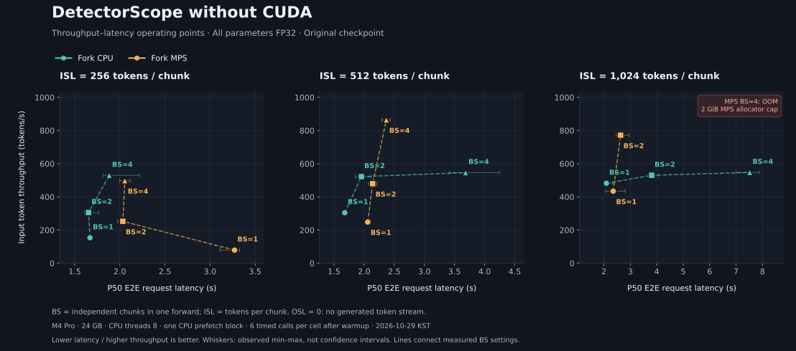
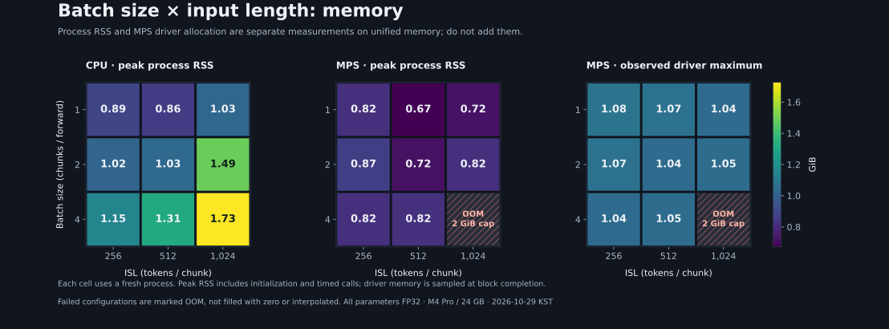

# About this fork

**Status: 2026-10-31 KST.**

## Why this fork exists

I'm a Mac user. I wanted DetectorScope to be practical for everyday document checks without CUDA. This fork focuses on usable **CPU and Apple Silicon/MPS performance**, with manageable memory use.

Against our [historical full-model CPU run](#historical-cpu-reference), the fork's CPU path was **at least 8× faster at P50** and used **under one-sixth the peak process RSS** in FP32 batch-1 tests with 256–1,024 input tokens.

## Model specification

The backbone is [Gemma 2, a decoder-only causal LLM](https://ai.google.dev/gemma/docs/core/model_card_2), used here to extract features from the supplied text. **Decoder-only describes its architecture.** Detection runs forward passes over the input; it does not run the autoregressive loop that generates new tokens one at a time.

The inference path is **input text → Gemma 2 hidden states → sparse autoencoder (SAE) features → logistic regression → detection result**.

| Property | Specification |
|---|---|
| Released model | `liamdugan/detector-scope`, based on Gemma-2-2B |
| Parameters | **2.614B backbone + approximately 0.302B SAE parameters** |
| Parameter precision | **All parameters are FP32**: backbone, SAEs and classifier |
| Weight size | Approximately **10.86 GiB** of backbone + SAE tensor data |
| Transformer blocks | **26 total; 23 executed (0–22)**. Features use inputs to blocks 8, 14, 18 and 23 |
| Block dimensions | Hidden 2304; FFN 9216; 8 query / 4 KV heads; head dimension 256 |
| Native maximum context | **8,192 tokens**; alternating full and sliding attention, with a **4,096-token** local window |
| Detector chunk limit | **1,024 tokens including special tokens**. Longer documents are split into independent contexts |
| Detection head | Four SAEs with 16,384 features each, followed by logistic regression; this runner retains the **449 encoder features** used by the selected head |

Each independent input chunk returns a [detection result](../detectorscope/model/detectors/auditable.py): **`label`** (`ai` or `human`), **`p_ai`** (the classifier's AI probability score, 0–1), and **`features`** with their contributions to the decision. Optional **highlights** locate those features in the input. Feature descriptions come from saved metadata; inference retrieves them. Long documents receive separate results for their chunks.

Model revision: `9baaff9e2d1cdb79cafa90cdb27811b847e69dae`. Parameter counts, dtypes and context limits were checked against this checkpoint.

**Current development and everyday use remain based on the original published weights at FP32.** Low-precision execution is future work, with the original FP32 model as the reference.

## Test environment

| Component | Configuration |
|---|---|
| Chip / CPU | **Apple M4 Pro, 12 CPU cores: 8 performance + 4 efficiency** |
| GPU | **16 Apple GPU cores**, using PyTorch MPS |
| RAM | **24 GB unified memory** |
| OS | macOS 26.6.2 |
| Runtime | Python 3.13; PyTorch 2.14.1; Transformers 4.57.6 |
| Benchmark CPU threads | 8 compute threads; one weight-prefetch thread in streamed runs |
| Current worker | **MPS FP32, maximum batch 2**, chunk limit 1,024 tokens, shared prefetch enabled |
| GPU allocation budget | **2 GiB MPS allocator limit**; not a process-wide RAM cap |
| Whole-worker budget | **3 GiB macOS memory footprint watchdog**, including CPU and Metal memory |

## Worker memory budget

On macOS, `detectorscope serve` now starts a separate memory watchdog before
loading PyTorch or the checkpoint. The default is 3 GiB, configurable with
`--memory-limit-gib`:

```sh
detectorscope serve --device mps --dtype float32 --batch-size 2 --memory-limit-gib 3 --shared-prefetch
```

It uses macOS `phys_footprint`, which includes CPU and Metal allocations plus
compressed/swapped memory charged to the worker. It covers tokenization,
prefetch, inference, highlights and the result cache. Clean file-cache pages
are reclaimable and are excluded by this metric; RSS and MPS driver memory
must not be added to it. [Apple's explanation of memory footprint](https://developer.apple.com/videos/play/wwdc2022/10106/).

The watchdog checks every 50 ms and uses the kernel's lifetime peak to catch
spikes between samples. If the peak exceeds the budget, it logs the measured
value and terminates the worker. An in-flight request may disconnect, and the
worker needs restarting. **This is a stop-on-breach guard, not an OS allocation
barrier:** scheduling and polling allow temporary overshoot. The small,
stdlib-only watchdog process has its own memory outside the worker's budget.

`GET /health` reports the limit, current footprint and lifetime peak in bytes.
The existing 2 GiB MPS allocator limit and one-block/one-prefetch policy still
apply. The new watchdog is enabled for the Mac CLI worker; direct Python model
calls do not start it automatically. `--memory-limit-gib 0` explicitly disables
it, and non-Mac workers leave it disabled by default.

## Performance

Batch size (**BS**) and tokens per chunk (**ISL**) are separate knobs. We track **P50 E2E request latency**, **input token throughput** (valid tokens / total timed seconds), and **memory**. The CSVs also include backbone prefill throughput: valid tokens / 23-block extractor time, including weight I/O and excluding SAE/scoring. There is no generated output, so Interactivity, TTFT and TPOT do not apply.

The grid below is from `c0106d1`, before the prefetch and normalization changes: CPU/MPS × BS {1, 2, 4} × ISL {256, 512, 1024}, all FP32. Each point has one warmup and six timed calls. Timing includes tokenization, weight I/O and detection; startup, HTTP and highlights are excluded. Whiskers show min–max. The worker was paused; filesystem cache, clocks and other apps were not controlled.



CPU wins at 256 tokens in this grid. MPS does better with more work per batch: at BS=2, ISL=1024, it reaches **772 input tok/s**, versus CPU's **530**. BS=4, ISL=1024 runs out of MPS memory under the 2 GiB limit.



RSS and sampled MPS driver allocation are shown separately; they should not be added on unified memory. Driver samples can miss transient peaks.

The prefetch change reduced transfer time by **20–27%**, but E2E P50 improved only **0.5–4.7%** and input throughput changed **−1.5% to +1.7%**. Outputs and highlights matched exactly on the tested fixtures.

The new FP32 normalization change reduced long-batch compute by about **5%** in a shuffled comparison. Paired median request savings were **100–154 ms** for the two long-batch workloads; short inputs showed no consistent benefit. Cache variation and an outlier prevent a general throughput claim. Labels and feature identities matched, with small numeric differences. [Results and reproduction](mac-normalization.md).

[Grid numbers](assets/mac-benchmark-grid.csv) · [Latest prefetch comparison](assets/mac-prefetch-comparison.csv)

The latest change adds `--shared-prefetch`: CPU reads fill shared MPS buffers
directly, avoiding a separate weight copy. Together with cache reuse between
blocks, this reduced P50 by **13–22%** in a fresh-process comparison against
`44302d8`. Two full windows went from **2.554 to 2.213 s**; one 1024-token window
went from **2.228 to 1.749 s**. Scores and highlights matched exactly, and maximum
process footprint fell from **2.000 to 1.715 GiB**. These results cover four
fixtures with eight timed calls each. [Kernel investigation, measurements and
reproduction](mac-memory-reuse.md).

### Historical CPU reference

The opening comparison uses a full-model CPU run from Oct 28: FP32, BS=1, 256–1024 tokens, three timed calls per input after warmup. It is **not a verified unmodified-upstream baseline**.

## What this fork does

Weights move from storage through CPU to MPS one block at a time: **one GPU compute block and one CPU prefetch slot**. CPU execution keeps only the current and next blocks. Adjacent reads share a reusable CPU buffer on MPS, and parameter copies are queued before a block-level wait. The buffer is reused only after those copies finish.

We also skip unused model/SAE work, reduce FFN work on padded batches and use PyTorch's fused RMSNorm on MPS FP32. Freed MPS allocations can be reused between blocks, with unused cache returned after each forward. Original FP32 weights and the **2 GiB MPS allocator limit** stay in place, with the Mac worker's **3 GiB process footprint watchdog** covering CPU memory too.

The optional shared path uses two MPS-backed weight buffers with the same
current-block and CPU-prefetch roles. It synchronizes before reusing a slot and
before GPU consumption, then releases both slots after the forward. The CLI
sets a lower reclamation threshold (`PYTORCH_MPS_LOW_WATERMARK_RATIO=0.05`) before
Torch loads, preserving an explicit environment override. The allocation caps
stay unchanged. This path requires PyTorch's private host-alias API, tested on
2.14.1; omit `--shared-prefetch` to keep the ordinary copy path.

## TODO

- Improve the remaining FP32 FFN matrix products and exposed weight reads.
- Check attention softcapping semantics and try more representative workloads.
- Explore low precision later. **Current development and everyday use stay on the original FP32 model.**
